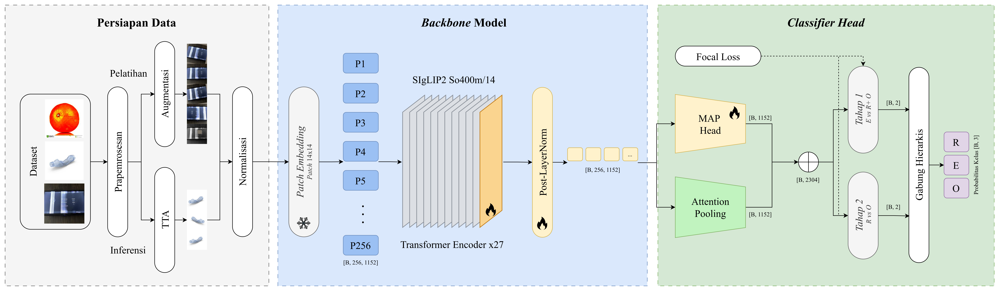

# Waste Image Classification

Classifies waste images into **Recyclable**, **Electronic** and **Organic** by partially fine-tuning SigLIP 2 SO400M/14, with attention pooling and a two-stage hierarchical head.



## Method

- **Data:** 26,527 labelled images (Organic 47.4%, Recyclable 37.7%, Electronic 14.9%) and 1,458 unlabelled test images. Stratified 90:10 train/val split (seed 1000); validation images are never augmented.
- **Preprocessing:** EXIF fix, RGB, aspect-preserving resize and pad to 224×224, normalisation.
- **Augmentation:** 4 extra views per training image (crop, flip, rotation, translation, colour jitter, blur, grayscale, cutout), cached deterministically. Training set: 119,370 rows with the originals.
- **Encoder:** vision tower of `google/siglip2-so400m-patch14-224` (27 layers, 427.7M params). Only the last layer, post-LayerNorm and pooler are trained (30.5M params, ~7.1%).
- **Features:** pooled output (1152-d) concatenated with a learned attention pooling over patch tokens (1152-d), giving 2304-d.
- **Head:** two binary MLPs (LayerNorm, 512, GELU, dropout 0.3). Stage 1 separates Electronic from the rest. Stage 2 separates Recyclable from Organic and is trained on non-Electronic images only. Outputs are combined with the chain rule:
  `P(E) = P_E`, `P(R) = (1 − P_E)·P_R|¬E`, `P(O) = (1 − P_E)·(1 − P_R|¬E)`.
- **Loss:** focal loss, γ = 4, inverse-frequency class weights, summed over both stages.
- **Training:** AdamW, LR 5e-5 (encoder) / 1e-3 (heads), weight decay 1e-2. 2-epoch warmup then cosine decay, max 20 epochs, early stopping with patience 5 on validation macro-F1. FP16, gradient checkpointing, batch size 256 on 2× T4.
- **Inference:** test-time augmentation averaging 3 views (original, horizontal flip, 90% centre crop). The checkpoint with the best validation macro-F1 is used.

## Results

Best checkpoint (epoch 2), validation set of 2,653 images:

| Macro-F1 | Accuracy |
|---|---|
| 99.29% | 99.21% |

| Class | Precision | Recall | F1 |
|---|---|---|---|
| Recyclable | 98.80% | 99.20% | 99.00% |
| Electronic | 99.25% | 100.00% | 99.62% |
| Organic | 99.52% | 98.97% | 99.25% |

Confusion matrix (rows = true, columns = predicted):

| | Recyclable | Electronic | Organic |
|---|---|---|---|
| Recyclable | 992 | 2 | 6 |
| Electronic | 0 | 396 | 0 |
| Organic | 12 | 1 | 1,244 |

Validation macro-F1 peaked at epoch 2 and early stopping ended training at epoch 7. TTA changed 5 of 1,458 test predictions. Test labels are not public, so no test score is reported.

## Files

| Path | Content |
|---|---|
| `notebooks/01_augmentation.ipynb` | build the augmentation cache |
| `notebooks/02_training.ipynb` | training |
| `notebooks/03_inference.ipynb` | TTA inference; reproduces the submission file |
| `report/report.pdf` | methodology report (Indonesian) |
| `train/`, `test/` | sample images only |

Model weights (1.6 GB): [Hugging Face](https://huggingface.co/datasets/ayaayaa/train-val-best-test/blob/main/train_val_best_test.pt)

## Dataset

The full dataset is not included because of repository size limits. Only 5 images per training class and 5 test images are kept as samples. To rerun the notebooks, place the full data in the same layout:

```
train/0_Recyclable/  train/1_Electronic/  train/2_Organic/  test/
```

## License

MIT. See [LICENSE](LICENSE). The sample images come from the original dataset and are not covered by this license.
